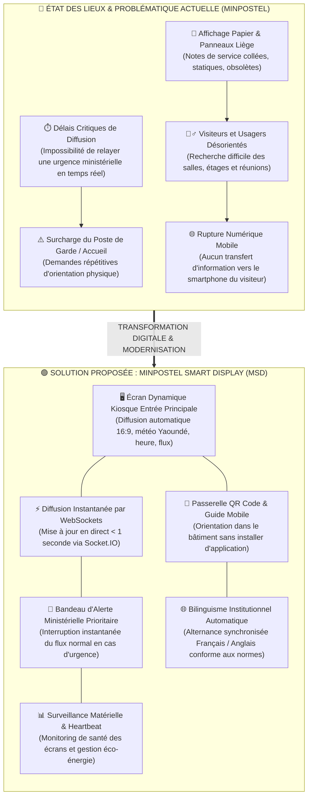
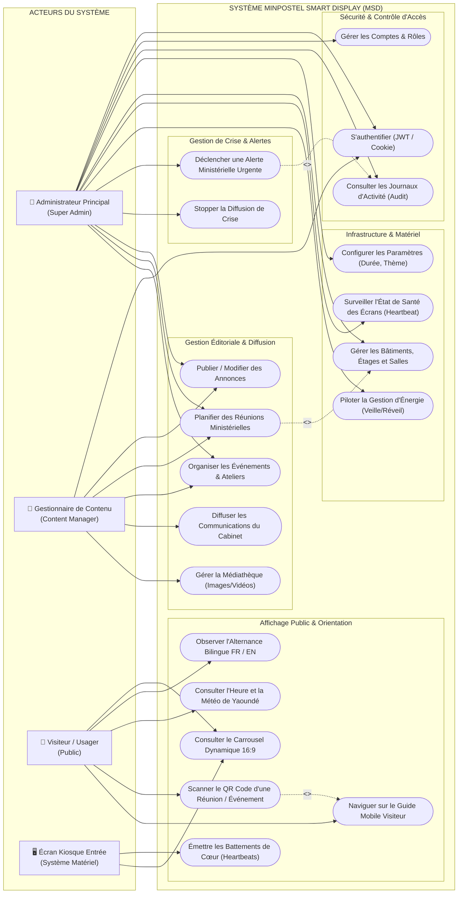
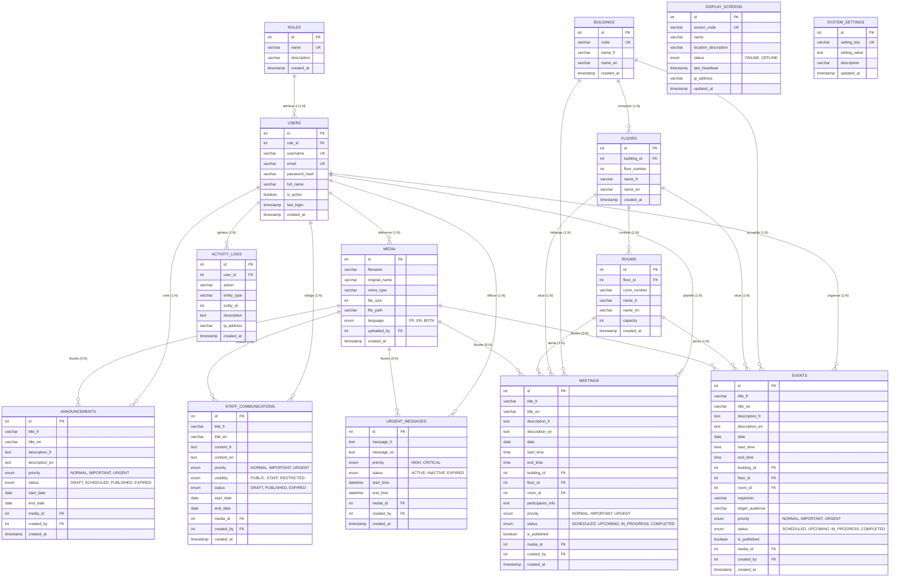
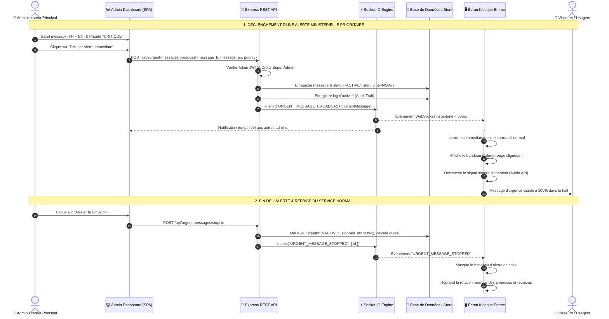
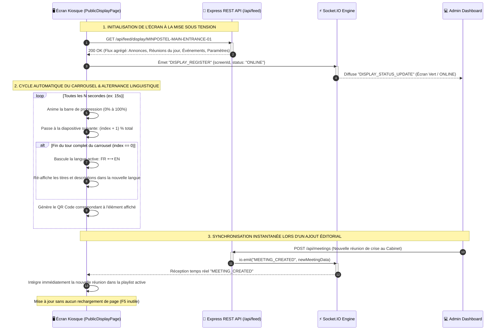
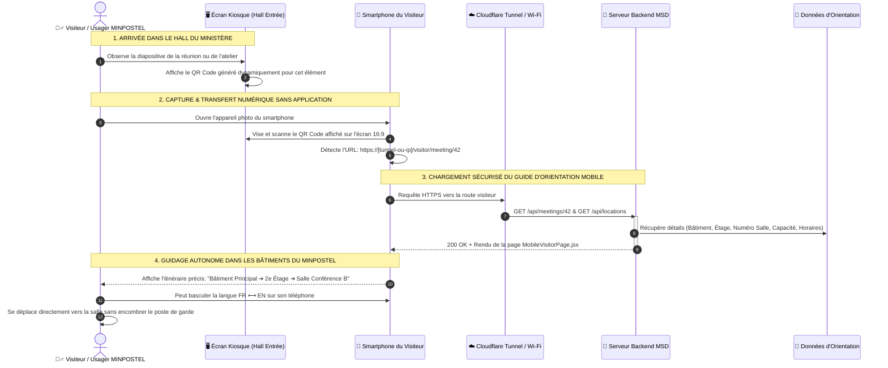
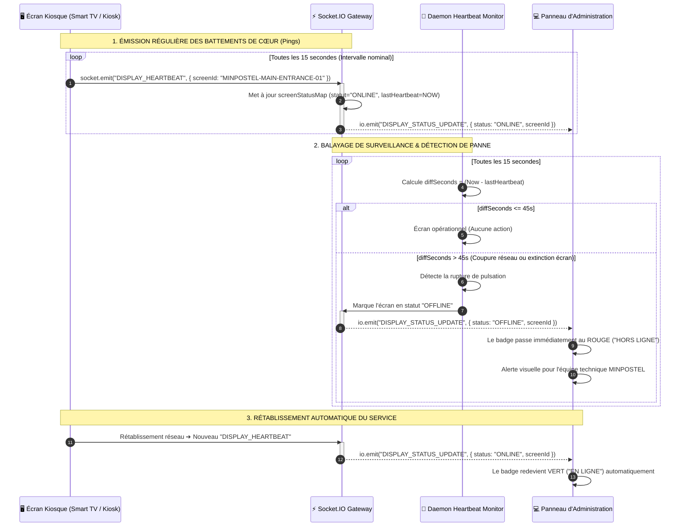
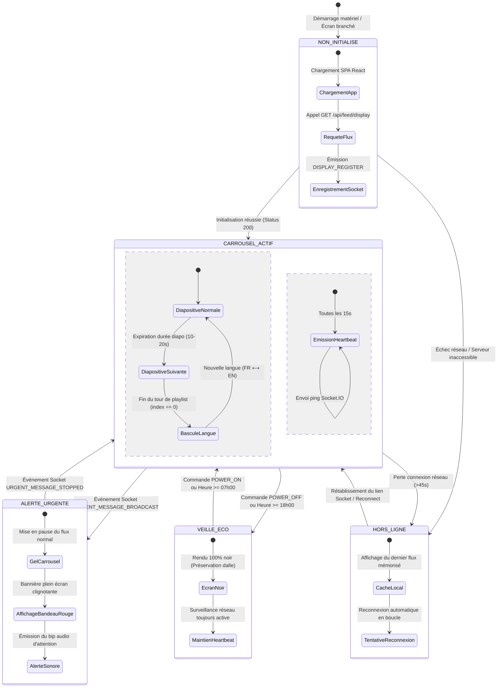
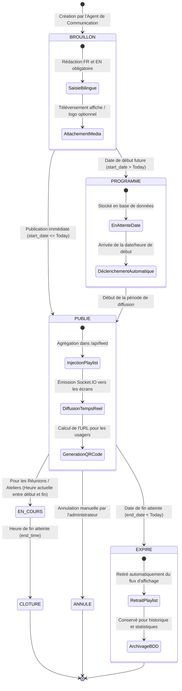

# MINPOSTEL SMART DISPLAY (MSD)
## Dossier d'Architecture et Conception Logicielle
> **Thème du Stage :** Conception et développement d'un système intelligent de gestion et d'affichage dynamique des informations au sein du Ministère des Postes et Télécommunications (MINPOSTEL).

---

## Sommaire Exécutif

Le présent document constitue le dossier officiel d'architecture et de conception logicielle du projet **MINPOSTEL Smart Display (MSD)**. Il est structuré pour permettre à l'étudiant d'expliquer avec précision à son tuteur de stage et au jury académique :
1. La problématique institutionnelle identifiée et la solution apportée.
2. La typologie des acteurs et la modélisation fonctionnelle (Cas d'Utilisation UML).
3. L'architecture logicielle modulaire en 4 tiers (Modèle C4 Container).
4. Le modèle de données relationnel (Diagramme Entité-Association / ERD).
5. Les dynamiques d'exécution en temps réel (Diagrammes de séquence).
6. Les machines à états-transitions régissant l'écran et les contenus.
7. La topologie physique et le déploiement réseau dans les locaux du MINPOSTEL.

> 💡 **Visualiseur Interactif :** Un visualiseur autonome prêt pour la soutenance est disponible dans [`docs/diagrams/view_diagrams.html`](file:///c:/Users/SOREL/Desktop/MINPOSTEL%20SMART%20DISPLAY%20%20%28MSD%29/docs/diagrams/view_diagrams.html). Il permet de parcourir tous les diagrammes avec zoom et rendu vectoriel dans n'importe quel navigateur web.

---

## 1. Contexte, Problématique & Solution Proposée

### 1.1 Contexte Institutionnel
Le Ministère des Postes et Télécommunications (MINPOSTEL) est l'organe central de l'État camerounais chargé de la formulation, de la mise en œuvre et du suivi de la politique gouvernementale en matière de télécommunications, de TIC et de services postaux. 
Chaque jour, le hall d'entrée principal du ministère accueille des délégations officielles, des usagers du service public, des partenaires techniques et des membres du cabinet ministériel.

### 1.2 Problématique Identifiée
L'audit du système d'information et d'accueil physique préalable au stage a révélé des freins opérationnels majeurs :
- **Affichage papier statique & obsolète :** Les communiqués, convocations de réunions et avis sont imprimés sur papier et punaisés sur des panneaux en liège, provoquant un encombrement visuel et une dégradation rapide des supports.
- **Désorientation des visiteurs :** Les usagers ignorent fréquemment dans quel bâtiment, à quel étage ou dans quelle salle se tient leur commission ou réunion, ce qui engendre des retards et encombre le poste de garde.
- **Incapacité de communication d'urgence en temps réel :** En cas d'incident, de crise sécuritaire ou d'instruction urgente du Ministre, aucun canal centralisé ne permettait de diffuser instantanément une consigne sur l'ensemble de l'enceinte ministérielle.
- **Rupture numérique mobile :** Aucun pont n'existait pour transférer l'information consultée à l'accueil vers le smartphone de l'usager sans nécessiter l'installation complexe d'une application mobile.

### 1.3 Diagramme 01 : Contexte Problème vs Solution


---

## 2. Spécification des Acteurs & Diagramme des Cas d'Utilisation

### 2.1 Description des Acteurs
1. **Administrateur Principal (Super Admin) :** Dispose des privilèges complets sur l'infrastructure (gestion des utilisateurs, attribution des rôles, journalisation d'audit, déclenchement des alertes de crise, supervision de la santé des écrans et configuration du réseau/tunnel).
2. **Gestionnaire de Contenu (Content Manager) :** Responsable de la cellule de communication ministérielle. Rédige, planifie et modifie les annonces, les réunions, les événements, téléverse les affiches officielles et consulte la prévisualisation de l'écran.
3. **Visiteur / Usager Public :** Consulte l'écran physique dans le hall d'entrée (heure, météo, diaporamas), observe l'alternance bilingue FR/EN, et scanne le QR code d'une réunion avec son smartphone pour obtenir l'orientation jusqu'à la salle.
4. **Écran Kiosque (Acteur Système Autonome) :** Appareil connecté physique (Smart TV / Kiosque d'affichage). S'enregistre automatiquement au démarrage, transmet des pulsations de vie (heartbeats) toutes les 15 secondes, bascule la langue à la fin de chaque boucle de playlist, et passe en mode veille écologique la nuit.

### 2.2 Diagramme 02 : Cas d'Utilisation UML (Use Case)


---

## 3. Architecture Logicielle & Modèle C4 (Container)

Le système adopte une architecture multi-tiers hautement résiliente conçue pour fonctionner avec ou sans accès à Internet.

### 3.1 Décomposition des Niveaux
- **Tier 1 - Présentation (Frontend React 18 & Vite) :** Composé de trois applications monopages (SPA) :
  - *Admin Dashboard* (`/dashboard`) : Interface d'administration institutionnelle.
  - *Public Display Screen* (`/display/:screenId`) : Vue plein écran 16:9 auto-animée pour TV commerciale.
  - *Mobile Visitor Portal* (`/visitor`) : Vue progressive optimisée pour smartphones lors du scan de QR codes.
- **Tier 2 - Passerelle & Transport Réseau :**
  - *Réseau Local LAN / Wi-Fi MINPOSTEL :* Permet une diffusion locale ultra-rapide sans latence.
  - *Tunnel Sécurisé Cloudflare (`cloudflared`) :* Crée un tunnel HTTPS sortant chiffré vers Internet pour permettre aux usagers en données cellulaires (4G/5G) de scanner et d'ouvrir le guide d'orientation.
  - *Moteur d'Événements WebSocket (`Socket.IO`) :* Canal bi-directionnel à moins de 50 millisecondes de latence pour la synchronisation immédiate des écrans.
- **Tier 3 - Métier & Application (Node.js + Express.js) :**
  - Contrôleurs RESTful avec authentification JWT et hashing Bcrypt.
  - Service de gestion d'énergie (`power.service.js`) programmant la mise en veille nocturne.
  - Moniteur de battements de cœur (`display.socket.js`) détectant les pannes d'écran après 45 secondes sans ping.
- **Tier 4 - Persistance Résiliente Polyvalente :**
  - *PostgreSQL / Supabase :* Base de données Cloud pour la synchronisation distante.
  - *MySQL 8.0+ :* Base de données relationnelle locale sur site (On-Premises).
  - *Moteur Local JSON Résilient (`msd_store.json`) :* Système de cache mémoire à écriture asynchrone qui prend le relais instantanément si les serveurs SQL sont coupés ou hors ligne.

### 3.2 Diagramme 03 : Architecture Système (C4 Container)

```mermaid
flowchart TB
    subgraph CLIENT_TIER ["1. COUCHE PRÉSENTATION (Frontend React 18 + Vite)"]
        direction LR
        UI_ADMIN["💻 Panneau d'Administration Web<br/><b>Admin Dashboard (SPA)</b><br/>• React 18 / Lucide Icons<br/>• Gestion de contenu & audits<br/>• Déclencheur d'alertes"]
        UI_KIOSK["🖥️ Écran d'Affichage Kiosque<br/><b>Public Display View</b><br/>• Format 16:9 Full HD / 4K<br/>• Carrousel synchronisé & Météo<br/>• Générateur dynamique de QR Codes"]
        UI_MOBILE["📱 Portail Visiteur Mobile<br/><b>Mobile Visitor Webapp</b><br/>• Vue responsive sans installation<br/>• Orientation salles, étages, horaires<br/>• Accessible sur Wi-Fi ou 4G/5G"]
    end

    subgraph GATEWAY_TIER ["2. PASSERELLE RÉSEAU & TRANSPORT SÉCURISÉ"]
        direction LR
        GW_LAN["🏢 Réseau Local LAN / Wi-Fi MINPOSTEL<br/>(HTTP / WebSocket direct: Ports 5000 & 5173)"]
        GW_TUNNEL["☁️ Service Tunnel Cloudflare (cloudflared)<br/>(Tunnel HTTPS sécurisé pour accès cellulaire 4G/5G)"]
        GW_WS["⚡ Moteur d'Événements WebSocket<br/>(Socket.IO bi-directionnel à faible latence)"]
    end

    subgraph SERVER_TIER ["3. COUCHE MÉTIER & APPLICATION (Node.js + Express.js)"]
        direction TB
        subgraph API_ROUTERS ["Contrôleurs & Routes RESTful"]
            direction LR
            R_AUTH["🔐 Auth (JWT & Bcrypt)"]
            R_CONTENT["📢 Content (Annonces, Réunions, Events)"]
            R_URGENT["🚨 Urgent Alerts (Broadcast)"]
            R_MEDIA["🖼️ Media Manager (Multer)"]
            R_LOC["🏢 Locations (Salles/Étages)"]
            R_SET["⚙️ System Settings & Logs"]
        end

        subgraph BG_SERVICES ["Services d'Arrière-Plan & Daemons"]
            direction LR
            S_SOCKET["📡 Sockets Gateway<br/>(Rooms & Channels)"]
            S_HEARTBEAT["💓 Moniteur Heartbeat<br/>(Détection panne écran >45s)"]
            S_POWER["🌙 Power Manager<br/>(Veille & Réveil programmés)"]
            S_TUNNEL_SVC["🌐 Tunnel Watcher<br/>(Auto-reconnexion & backoff)"]
        end
    end

    subgraph DATA_TIER ["4. COUCHE PERSISTANCE & DONNÉES (Architecture Résiliente)"]
        direction LR
        DB_POSTGRES[("🐘 PostgreSQL / Supabase<br/>(Base distante Cloud & Pooling)")]
        DB_MYSQL[("🐬 MySQL 8.0+ / MariaDB<br/>(Base relationnelle On-Premises)")]
        DB_JSON[("💾 Store Local JSON & RAM<br/>(msd_store.json - Tolérance aux pannes)")]
        STORAGE_FS[("📁 Système de Fichiers /uploads<br/>(Affiches, Médias, Images)")]
    end

    UI_ADMIN -->|"HTTP REST & JWT"| GW_LAN
    UI_KIOSK -->|"WebSocket & HTTP"| GW_LAN
    UI_MOBILE -->|"HTTP / QR Target"| GW_TUNNEL
    UI_MOBILE -.->|"Alternative Wi-Fi"| GW_LAN

    GW_LAN --> R_AUTH
    GW_LAN --> R_CONTENT
    GW_LAN --> R_URGENT
    GW_LAN --> R_MEDIA
    GW_LAN --> R_LOC
    GW_LAN --> R_SET
    GW_TUNNEL --> R_CONTENT
    GW_TUNNEL --> R_LOC

    GW_LAN <==>|"Bi-directional Sync"| GW_WS
    GW_WS <==> S_SOCKET

    S_SOCKET --> UI_KIOSK
    S_SOCKET --> UI_ADMIN
    S_HEARTBEAT --> S_SOCKET
    S_POWER --> S_SOCKET
    S_TUNNEL_SVC -.-> GW_TUNNEL

    R_AUTH & R_CONTENT & R_URGENT & R_LOC & R_SET ==>|"Driver Polyvalent"| DB_POSTGRES
    R_AUTH & R_CONTENT & R_URGENT & R_LOC & R_SET -.->|"Mode Local On-Prem"| DB_MYSQL
    R_AUTH & R_CONTENT & R_URGENT & R_LOC & R_SET ==>|"Repli Résilient Automatique"| DB_JSON
    R_MEDIA --> STORAGE_FS
```


---

## 4. Organisation de la Base de Données (Diagramme Entité-Association)

Le modèle de données répond à 3 exigences majeures :
1. **La binarité linguistique (Bilinguisme constitutionnel) :** Tous les champs textuels destinés au public possèdent une version française (`_fr`) et une version anglaise (`_en`).
2. **La modélisation de l'espace physique :** Relation stricte de containment : `buildings` (1) ➔ `floors` (N) ➔ `rooms` (N) permettant de géolocaliser n'importe quelle salle de réunion.
3. **La traçabilité et l'auditabilité :** Chaque action administrative sensible est enregistrée dans `activity_logs` avec l'adresse IP et l'identifiant de l'agent.

### 4.1 Diagramme 04 : ERD Relationnel Complet


---

## 5. Dynamiques du Système (Diagrammes de Séquence)

### 5.1 Diagramme 05 : Alerte Ministérielle d'Urgence en Temps Réel
Illustre la propagation immédiate d'un message critique via WebSockets et la substitution prioritaire de l'affichage normal sur l'écran kiosque.


### 5.2 Diagramme 06 : Carrousel Dynamique & Alternance Bilingue FR / EN
Illustre le fonctionnement autonome de l'écran 16:9 dans le hall d'entrée : rotation minutée et bascule de langue automatique.


### 5.3 Diagramme 07 : Passerelle QR Code & Guidage Visiteur Mobile
Montre le transfert fluide de l'écran public vers le smartphone personnel du visiteur.


### 5.4 Diagramme 08 : Surveillance Heartbeat et Tolérance aux Pannes
Explique la détection automatique des pannes d'écran par l'infrastructure centrale.


---

## 6. Diagrammes de Machines à États

### 6.1 Diagramme 09 : Cycle de Vie de l'Écran Kiosque


### 6.2 Diagramme 10 : Cycle de Vie Éditorial des Contenus


---

## 7. Déploiement Physique & Topologie Réseau

### 7.1 Implantation dans les Bâtiments du MINPOSTEL
L'architecture physique met en relation :
1. **Le Hall d'Entrée (Rez-de-chaussée) :** Une Smart TV 65 pouces 16:9 connectée en Wi-Fi ou HDMI à un lecteur multimédia (Mini-PC / Android TV).
2. **Le Bureau de Communication / DSI :** Les postes de travail administrant la plateforme via navigateur web.
3. **Le Serveur Hôte :** Un ordinateur ou serveur local exécutant Node.js (Port 5000), Vite (Port 5173) et le démon `cloudflared`.
4. **Les Usagers Mobiles :** Connectés soit sur le Wi-Fi Visiteur du Ministère, soit sur leur forfait 4G/5G via la passerelle Cloudflare.

### 7.2 Diagramme 11 : Topologie Réseau & Déploiement
```mermaid
flowchart TB
    subgraph SITE_MINPOSTEL ["🏛️ SITE DU MINISTÈRE DES POSTES ET TÉLÉCOMMUNICATIONS (YAOUNDÉ)"]
        
        subgraph ZONE_HALL ["📍 Hall de l'Entrée Principale (Rez-de-Chaussée)"]
            TV_SCREEN["📺 Écran Géant Kiosque 55''- 65'' (16:9)<br/><b>Affichage Dynamique Principal</b><br/>• Résolution 1080p / 4K Landscape<br/>• Navigateur Web Tizen/WebOS/Android TV<br/>• URL: http://[IP_SERVEUR]:5173/display/MINPOSTEL-MAIN-ENTRANCE-01"]
            SMARTPHONES["📱 Smartphones des Visiteurs & Usagers<br/>• Scannent les QR codes en direct<br/>• Connexion Wi-Fi Invité ou Données Mobiles 4G/5G"]
        end

        subgraph ZONE_ADMIN ["💼 Cellule de Communication & DSI (Bâtiment Principal)"]
            PC_ADMIN["💻 Ordinateur du Gestionnaire / DSI<br/>• Navigateur moderne (Chrome / Edge / Firefox)<br/>• URL: http://[IP_SERVEUR]:5173/login<br/>• Publication, gestion de crise, supervision"]
        end

        subgraph ZONE_SERVER ["🖥️ Serveur Hôte d'Application (PC Local / Mini-PC NUC)"]
            APP_SRV["⚙️ Serveur Backend Node.js (Port 5000)<br/>• API Express & Moteur Socket.IO<br/>• Daemons Heartbeat & Power Management"]
            APP_CLIENT["🌐 Serveur Frontend Vite / Client (Port 5173)<br/>• Distribution des SPAs React 18"]
            DB_LOCAL[("💾 BDD MySQL 8.0 / Store msd_store.json<br/>• Données locales & tolérance aux pannes")]
            STORAGE_LOCAL[("📁 Répertoire Disque /uploads<br/>• Stockage des visuels et affiches")]
            CF_DAEMON["🛡️ Daemon cloudflared.exe<br/>• Tunnel chiffré sortant sans ouverture de port")]

            APP_SRV --- APP_CLIENT
            APP_SRV --- DB_LOCAL
            APP_SRV --- STORAGE_LOCAL
            APP_SRV --- CF_DAEMON
        end

        SWITCH_LAN["🔀 Routeur / Switch Wi-Fi & LAN MINPOSTEL<br/>(Sous-réseau IP Local: 10.x.x.x ou 192.168.x.x)"]
        
        TV_SCREEN <==>|"Liaison Wi-Fi ou HDMI Direct"| SWITCH_LAN
        PC_ADMIN <==>|"Liaison Réseau LAN"| SWITCH_LAN
        SWITCH_LAN <==>|"Ports 5000 & 5173"| APP_SRV
        SMARTPHONES -.->|"Wi-Fi Visiteur MINPOSTEL"| SWITCH_LAN
    end

    subgraph CLOUD_EXTERNE ["☁️ SERVICES CLOUD & INFRASTRUCTURE DISTANTE"]
        CF_EDGE["🌐 Réseau Anycast Cloudflare<br/>(Passerelle HTTPS sécurisée trycloudflare.com)"]
        SUPABASE_CLOUD[("🐘 Supabase / PostgreSQL Cloud<br/>(Base distante & Synchronisation)")]
        WEATHER_API["☀️ Service Météo (API Météo Yaoundé)"]
    end

    CF_DAEMON ==>|"Tunnel Chiffré TLS Sortant (Port 443)"| CF_EDGE
    CF_EDGE ==>|"Accès 4G/5G hors Wi-Fi"| SMARTPHONES
    APP_SRV -.->|"Pooling HTTPS"| SUPABASE_CLOUD
    APP_SRV -.->|"Requêtes API Météo"| WEATHER_API
```

---

## 8. Guide Pratique pour la Soutenance devant le Tuteur & le Jury

Lors de la présentation de votre projet, voici les **5 arguments d'ingénierie logicielle** clés à mettre en valeur :

1. **Tolérance aux pannes (Fault Tolerance) :**  
   *« Si la connexion Internet du ministère s'interrompt ou si la base SQL distante est inaccessible, le système ne plante jamais. Le moteur de repli asynchrone `store.util.js` bascule instantanément sur le cache local `msd_store.json` sans coupure d'affichage. »*
2. **Réactivité temps réel sub-seconde (<50 ms) :**  
   *« Grâce à l'architecture WebSocket (Socket.IO), le déclenchement d'une alerte ministérielle d'urgence ou la publication d'une réunion modifie l'écran du hall sans qu'aucun rechargement de page (F5) ne soit nécessaire. »*
3. **Respect strict du Bilinguisme d'État :**  
   *« Conformément à la Constitution du Cameroun, tous les contenus sont bilingues. L'écran alterne automatiquement entre le Français et l'Anglais à la fin de chaque rotation de carrousel. »*
4. **Transition physique-numérique sans friction (QR Handover) :**  
   *« L'usager ne télécharge aucune application sur l'App Store ou le Play Store. Il scanne simplement le QR code affiché à l'écran et son navigateur mobile ouvre immédiatement l'itinéraire vers la salle de réunion. »*
5. **Gestion éco-énergétique du matériel :**  
   *« Le système intègre un planificateur d'énergie éteignant l'affichage la nuit (18h00 - 07h00) pour prolonger la durée de vie des dalles d'écran et réduire la consommation électrique du ministère. »*
